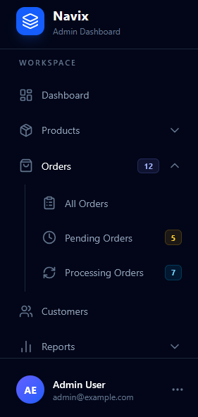

# Navix

Navix is a lightweight Laravel package for defining, organizing, and retrieving navigation menus with a simple, fluent API.

With Navix, you can easily create and manage navigation menus for different parts of your application, including admin panels, user dashboards, and the main application interface. It supports multiple navigation batches, nested menu items, icons, badges, URLs, and query parameters.

Navix also provides a simple way to search for menu items by label, including items nested inside groups.

## Features

- **Multiple Navigation Batches:** Organize menus for different areas of your application.
- **Nested Menu Items:** Create groups and subgroups with support for deeply nested navigation.
- **Fluent API:** Define menu items using a clean, chainable syntax.
- **Custom Icons:** Associate icon names with navigation items.
- **Badges:** Add badges to display counts or other labels.
- **Flexible URLs:** Configure URLs with query strings and additional parameters.
- **Recursive Search:** Search for menu items by label, including nested items.
- **Easy Integration:** Retrieve navigation data and render it using Blade or your preferred frontend approach.

## Preview



## Installation

Install Navix using Composer:

```bash
composer require abolaradev/navix
```

Next, run the installation command:

```bash
php artisan navix:install
```

This command creates the navigation definition file at `routes/navix.php`, where you can configure your application's navigation menus.

## Defining Navigation Menus

Navix organizes navigation menus into **batches**. Each batch represents a separate navigation menu for a specific area of your application, such as the admin panel, user dashboard, or main application.

Open `routes/navix.php` and define your batches:

```php
use Abolaradev\Navix\Facades\Navix;

Navix::batch('app', function () {
    // Define application navigation items.
});

Navix::batch('dashboard', function () {
    // Define dashboard navigation items.
});
```

You can create as many batches as your application needs. Each batch has a unique name that you can use later to retrieve its navigation items.

## Creating Navigation Items

To create a navigation item, use the `label()` method to set its name and optionally configure its icon, URL, and badge. Call `add()` to register a regular item.

```php
Navix::batch('dashboard', function () {
    Navix::label('Dashboard')
        ->icon('layout-dashboard')
        ->url('/dashboard')
        ->add();
});
```

### Available Configuration Methods

| Method | Description |
| --- | --- |
| `label(string $label)` | Sets the navigation item's label. |
| `icon(string $icon)` | Sets the icon name. |
| `badge(string\|int $badge)` | Sets a badge value. |
| `url(string $path, array $query = [], array $parameters = [])` | Configures the URL, query string, and additional parameters. |
| `add()` | Adds the configured item to the current batch or parent group. |

### Configuring URLs

The `url()` method accepts three arguments:

1. **Path:** The URL path.
2. **Query:** An associative array of query string parameters.
3. **Parameters:** Additional parameters passed to Laravel's URL query builder.

```php
Navix::label('Products')
    ->icon('package')
    ->url('/products', [
        'sort' => 'latest',
        'page' => 2,
    ])
    ->add();
```

You can also provide additional parameters using the third argument:

```php
Navix::label('Products')
    ->url('/products', ['sort' => 'latest'], ['source' => 'dashboard'])
    ->add();
```

## Nested Navigation Items

Use the `group()` method to create a group containing nested navigation items. It accepts a callback in which you define the group's children.

Groups are registered automatically by `group()`, so you do not need to call `add()` on the group itself.

```php
Navix::batch('dashboard', function () {
    Navix::label('Orders')
        ->icon('shopping-bag')
        ->badge(12)
        ->group(function () {
            Navix::label('All Orders')
                ->icon('clipboard-list')
                ->url('/orders', ['status' => 'all', 'per_page' => 20])
                ->add();

            Navix::label('Pending Orders')
                ->icon('clock')
                ->badge(5)
                ->url('/orders/pending', ['sort' => 'oldest'])
                ->add();

            Navix::label('Processing Orders')
                ->icon('refresh-cw')
                ->badge(7)
                ->url('/orders/processing')
                ->add();
        });
});
```

You can nest `group()` calls inside other groups to create navigation structures with multiple levels.

## Retrieving Navigation Items

Navix provides the `navix()` helper function to retrieve navigation items from a batch.

```php
$items = navix('dashboard');
```

The helper accepts two arguments:

- **Batch:** The name of the navigation batch to retrieve.
- **Search (optional):** A label or partial label to search for within that batch.

The helper returns a `NavixCollection` containing the matching navigation items. Each item is also represented by a `NavixCollection` instance.

### Accessing Navigation Items

You can iterate over the returned collection and access each item's properties through the provided methods.

```php
@foreach (navix('dashboard') as $item)
    <a href="{{ $item->getUrl() }}">
        {{ $item->getLabel() }}
    </a>
@endforeach
```

### Searching Navigation Items

Pass a search term as the second argument to search for matching labels:

```php
$items = navix('dashboard', 'Orders');
```

The search is case-insensitive and supports nested navigation items. When a nested item matches, its parent group can be retained so that the navigation hierarchy remains accessible.

Navix provides the navigation data; you can decide how to display search results in your application.

## NavixCollection

`NavixCollection` extends Laravel's `Illuminate\Support\Collection` and provides convenient methods for accessing navigation item properties and checking whether they exist.

### Getter Methods

| Method | Return Type | Description |
| --- | --- | --- |
| `getLabel()` | `string` | Returns the item's label. |
| `getIcon()` | `string` | Returns the item's icon name. |
| `getBadge()` | `string` | Returns the item's badge value. |
| `getUrl()` | `string` | Returns the item's URL. |
| `getSubItems()` | `NavixCollection` | Returns the item's nested navigation items. |

### Existence Methods

Use the `has` methods to check whether a navigation item contains a particular property before accessing it.

| Method | Return Type | Description |
| --- | --- | --- |
| `hasLabel()` | `bool` | Determines whether the item has a label. |
| `hasIcon()` | `bool` | Determines whether the item has an icon. |
| `hasBadge()` | `bool` | Determines whether the item has a badge. |
| `hasUrl()` | `bool` | Determines whether the item has a URL. |
| `hasSubItems()` | `bool` | Determines whether the item has nested items. |

### Example

```php
$items = navix('dashboard');

foreach ($items as $item) {
    if ($item->hasLabel()) {
        echo $item->getLabel();
    }

    if ($item->hasIcon()) {
        echo $item->getIcon();
    }

    if ($item->hasBadge()) {
        echo $item->getBadge();
    }

    if ($item->hasUrl()) {
        echo $item->getUrl();
    }

    if ($item->hasSubItems()) {
        $subItems = $item->getSubItems();
    }
}
```


If you find this package useful, please don't forget to give it a ⭐ on GitHub. ❤️

## Changelog

Please see [CHANGELOG](CHANGELOG.md) for more information on what has changed recently.

## Contributing

Please see [CONTRIBUTING](CONTRIBUTING.md) for details.

## Security Vulnerabilities

Please review [our security policy](../../security/policy) for information on how to report security vulnerabilities.

## Credits

* [abolaradev](https://github.com/abolaradev)

* [All Contributors](../../contributors)

## License

The MIT License (MIT). Please see [License File](LICENSE.md) for more information.
